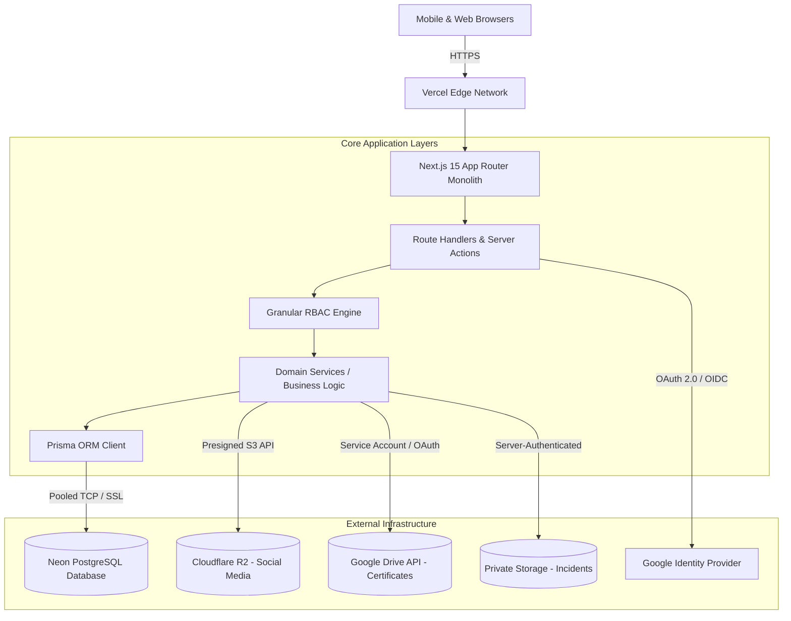

# Architecture.md — Application Architecture & Stack

> **Project:** SREC Connect v3.0  
> **Architecture Pattern:** Next.js Server-Side Modular Monolith  
> **Hosting & Infrastructure:** Vercel + Neon PostgreSQL + Cloudflare R2 + Google Drive API  

---

## 1. System Architecture Overview



---

## 2. Technology Stack & Key Decisions

| Layer | Technology | Rationale & Trade-offs |
|---|---|---|
| **Framework** | Next.js 15 (React 19, App Router) | Server-side rendering, Server Actions, route grouping, edge middleware |
| **Language** | TypeScript 5.7+ | End-to-end type safety with strict compiler flags |
| **Styling & UI** | Tailwind CSS + shadcn/ui | Radix UI accessible primitives, predictable token-based styling |
| **Icons & Motion** | Lucide React + Framer Motion | High-performance SVG icons and fluid micro-interactions |
| **Database** | Neon Serverless PostgreSQL | Auto-scaling compute, connection pooling (`DATABASE_URL`), branch environments |
| **ORM** | Prisma ORM 6.x | Strongly typed schemas, declarative migrations, automated client generation |
| **Authentication** | NextAuth.js / Google OAuth 2.0 | Session tokens via HTTP-only SameSite cookies, pre-provisioned matching |
| **Validation** | Zod 3.24+ | Runtime schema validation on Server Actions and API inputs |
| **Image Processing** | Sharp | Byte signature validation, EXIF stripping, WebP compression (<= 500 KB) |
| **Media Storage** | Cloudflare R2 | Zero-egress fee object storage for public/authenticated feed images |
| **Document Storage** | Google Drive API | Direct institutional storage for academic certificates and public PDFs |
| **Charts** | Recharts | Department analytics, verification metrics, and event registration trends |
| **Testing** | Vitest + Playwright | Fast unit tests + automated browser end-to-end verification |

---

## 3. Directory & Module Boundaries

The project adopts a domain-driven modular monolith folder structure inside `src/`:

```
src/
├── app/                              # Next.js App Router (Routes & Layouts)
│   ├── (public)/                     # Public department pages (Home, Faculty, Events)
│   ├── (auth)/                       # Sign-in & OAuth callback routes
│   ├── feed/                         # Social feed & post composer
│   ├── profile/                      # Student & Faculty profiles
│   ├── achievements/                 # Submissions & verification queues
│   ├── events/                       # Department events & QR check-in
│   ├── incidents/                    # Grievances & disciplinary management
│   ├── admin/                        # Super Admin & Web Manager consoles
│   └── api/                          # REST API endpoints & webhooks
├── components/                       # Shared UI components
│   ├── ui/                           # Primitive shadcn/ui components (buttons, dialogs, etc.)
│   ├── layout/                       # AppShell, MobileNavbar, DesktopSidebar, Header
│   └── feedback/                     # Skeletons, empty states, error boundaries
├── features/                         # Feature domain modules
│   ├── auth/                         # OAuth flow, session handling, domain validation
│   ├── users/                        # Student, faculty, user records & CSV import
│   ├── social/                       # Feed algorithms, post creation, likes, comments
│   ├── portfolio/                    # Academic skills, projects, verified badges
│   ├── achievements/                 # Review state machine, evidence verification
│   ├── events/                       # Registration, capacity transactions, QR check-in
│   ├── incidents/                    # Confidential grievances, responses, actions
│   └── documents/                    # Google Drive integration & R2 pipelines
├── lib/                              # Core shared utilities & singletons
│   ├── db/prisma.ts                  # Cached Prisma Client singleton
│   ├── auth/rbac.ts                  # Granular permission checker
│   ├── storage/                      # R2 & Google Drive clients
│   └── validation/                   # Shared Zod schemas
└── types/                            # Domain-wide TypeScript declarations
```

---

## 4. Multi-Tier Storage Architecture

| Data Classification | Storage Engine | Access Control Mechanism | Link Visibility |
|---|---|---|---|
| **Relational Data & Metadata** | Neon PostgreSQL | Foreign keys, indexes, transactional isolation | Internal only |
| **Social Feed Images** | Cloudflare R2 | Presigned upload URLs, Sharp WebP compression | Public CDN / App-restricted |
| **Academic Certificates** | Google Drive API | Backend service account / institutional account | Anyone with link — Viewer (with explicit disclosure) |
| **Grievance Evidence & Identity** | Private Storage | Server-side streamed downloads only | Private / Authorized roles only (Never public Drive) |

---

## 5. Security & Authorization Architecture

1. **Pre-Provisioned Account Match:**
   ```mermaid
   sequenceDiagram
       User ->> Google: Authenticate via Google OAuth
       Google -->> Server: Return ID Token (Email & Profile)
       Server ->> NeonDB: Query User where email = normalizedEmail
       alt Account Not Provisioned
           Server -->> User: Access Denied (Contact Web Manager)
       else Account Suspended
           Server -->> User: Account Suspended Notice
       else Valid Provisioned Account
           Server ->> NeonDB: Create / Refresh Session
           Server -->> User: Set HTTP-Only Session Cookie
       end
   ```
2. **Permission Model:**
   - Roles: `SUPER_ADMIN`, `HOD`, `WEB_MANAGER`, `FACULTY`, `STUDENT`.
   - Permissions: Granular string keys (`achievements.review`, `incidents.resolve`, `users.bulk_import`).
   - Server Actions enforce permissions via `requirePermission(user, 'key')` prior to any mutation.
