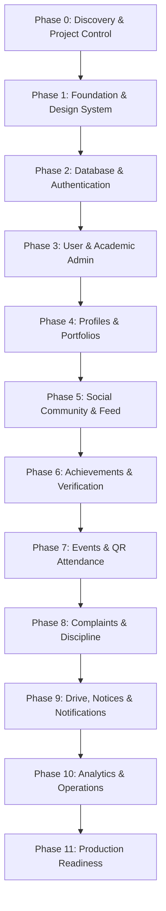

# Phases.md — Step-by-Step Implementation Roadmap

> **Methodology:** GSD Structured Phase Plan  
> **Rule:** Implement one phase at a time with atomic commits and empirical verification.

---

## Roadmap Overview

---

## Phase 0: Discovery & Project Control (Current Phase)
- **Objective:** Complete project inspection, environment verification, architecture planning, and documentation lock.
- **Tasks:**
  - [x] Task 0.1: Inspect repository, skills, CLIs, `.env`, and Google client secrets.
  - [x] Task 0.2: Author 6 mandatory GSD docs (`PRD.md`, `Architecture.md`, `Rules.md`, `Phases.md`, `Design.md`, `Memory.md`).
  - [x] Task 0.3: Author Blueprint documents in `docs/` (`PROJECT_BRIEF.md`, `REQUIREMENTS.md`, `ARCHITECTURE.md`, `SECURITY.md`, `DATA_MODEL.md`, `ASSET_SOURCES.md`, `DECISIONS.md`, `IMPLEMENTATION_PLAN.md`).
  - [ ] Task 0.4: Execute `plan-checker` verification and obtain user approval to unlock Phase 1.
- **Verification:** All 6 GSD docs + `docs/` specifications present; zero build regressions.
- **Status:** In Progress (Awaiting Review)

---

## Phase 1: Foundation & Design System
- **Objective:** Modern mobile-first app shell, theme provider (Light/Dark/System), Instagram/LinkedIn design primitives.
- **Tasks:**
  - [x] Task 1.1: Verify Next.js 15, Tailwind CSS, shadcn/ui setup, theme provider, and Lucide icons.
  - [x] Task 1.2: Build responsive navigation shell (Mobile Bottom Navigation + Desktop Sidebar).
  - [x] Task 1.3: Build public department landing page shell with authentic college placeholders.
- **Verification:** Captured Playwright screenshots of mobile (`mobile_feed.png`) and desktop (`desktop_feed.png`, `portfolios_tab.png`) in light/dark modes with clean typecheck.
- **Status:** Completed & Empirically Verified

---

## Phase 2: Database & Authentication
- **Objective:** Neon PostgreSQL integration, Prisma schema with granular RBAC, and Google OAuth flow.
- **Tasks:**
  - [x] Task 2.1: Implement updated Prisma schema with 5 roles (`SUPER_ADMIN`, `HOD`, `WEB_MANAGER`, `FACULTY`, `STUDENT`) and granular permission models.
  - [x] Task 2.2: Configure Google OAuth with pre-provisioned email matching and institutional domain check.
  - [x] Task 2.3: Implement secure Super Admin initial bootstrapping CLI/script.
- **Verification:** Unit and integration tests demonstrating rejection of unprovisioned emails, correct role assignment, and Neon PostgreSQL schema synchronization (14/14 tests passed in `tests/auth-rbac.test.ts`).
- **Status:** Completed & Empirically Verified

---

## Phase 3: User & Academic Administration
- **Objective:** Student and faculty provisioning, bulk CSV/Excel import with preview and row error tracking.
- **Tasks:**
  - [ ] Task 3.1: Bulk CSV/XLSX parser with schema validation, preview table, and error report.
  - [ ] Task 3.2: Department, Batch, and Section management with roll number uniqueness enforcement.
  - [ ] Task 3.3: Staff administrative edit workflow with audit history.
- **Verification:** Integration test uploading valid and malformed CSVs; audit logs verified in Neon.
- **Status:** Locked

---

## Phase 4: Profiles & Portfolios
- **Objective:** LinkedIn-inspired academic portfolios and Instagram-style profile headers.
- **Tasks:**
  - [ ] Task 4.1: Student profile view with editable portfolio fields and locked official academic fields.
  - [ ] Task 4.2: Faculty and HOD professional profile view (publications, patents, FDPs, mentoring).
  - [ ] Task 4.3: Granular privacy toggles (Public vs College-Only vs Private) per portfolio section.
- **Verification:** Visual verification of student vs faculty view; permission check ensuring students cannot modify roll numbers.
- **Status:** Locked

---

## Phase 5: Social Community & Feed
- **Objective:** Department-wide and personalized feed, post composer, Sharp image processing, and Cloudflare R2 uploads.
- **Tasks:**
  - [ ] Task 5.1: Post composer supporting text + max 2 images with Sharp WebP resizing (<= 500 KB).
  - [ ] Task 5.2: Cloudflare R2 presigned upload pipeline and media database storage.
  - [ ] Task 5.3: Feed rendering with likes, comments, bookmarks, and content reporting.
- **Verification:** Automated test ensuring 3rd image is rejected and image dimensions/WebP format are verified.
- **Status:** Locked

---

## Phase 6: Achievements & Verification
- **Objective:** Multi-tier achievement submission and verification review workflow.
- **Tasks:**
  - [ ] Task 6.1: Student achievement submission with proof document upload.
  - [ ] Task 6.2: Faculty review queue with approval, rejection, and resubmission request actions.
  - [ ] Task 6.3: HOD escalation queue and audit log tracking.
- **Verification:** State transition test verifying unverified achievements never display the Verified badge.
- **Status:** Locked

---

## Phase 7: Events & QR Attendance
- **Objective:** Department events lifecycle, registration, waitlist, and QR attendance check-in.
- **Tasks:**
  - [ ] Task 7.1: Event creation with audience targeting, seat limits, and optional WhatsApp link for registrants.
  - [ ] Task 7.2: Transactional student registration with capacity and waitlist management.
  - [ ] Task 7.3: Event check-in via organizer manual toggle and event-specific QR scanner.
- **Verification:** Concurrency test verifying capacity cannot be oversold; QR scanner verified for event check-in only.
- **Status:** Locked

---

## Phase 8: Complaints & Discipline Management
- **Objective:** Confidential student grievances and faculty disciplinary incident reporting.
- **Tasks:**
  - [ ] Task 8.1: Dual-track reporting forms (Grievance vs Incident Report) with priority levels.
  - [ ] Task 8.2: Confidential HOD bypass workflow for student grievances.
  - [ ] Task 8.3: Immutable response timeline with student right-to-respond and authorized action logging.
- **Verification:** Permission test proving non-authorized users cannot access or view incident records.
- **Status:** Locked

---

## Phase 9: Google Drive, Notices & Notifications
- **Objective:** Google Drive API integration for official PDFs, announcements, and multi-channel notifications.
- **Tasks:**
  - [ ] Task 9.1: Google Drive backend service for uploading verified certificates with public-link disclosure.
  - [ ] Task 9.2: Announcements system with audience filtering (batch, section, role).
  - [ ] Task 9.3: In-app notification center and user preference controls.
- **Verification:** Integration test verifying Drive permissions and isolation of sensitive incident attachments.
- **Status:** Locked

---

## Phase 10: Analytics, Public Portal & Operations
- **Objective:** Department analytics dashboards, global search, and public website finalization.
- **Tasks:**
  - [ ] Task 10.1: Department metrics with Recharts (registrations, verified achievements, activity breakdown).
  - [ ] Task 10.2: Role-aware global search across students, faculty, events, and posts.
  - [ ] Task 10.3: Public SEO metadata, sitemap generation, and robots.txt rules.
- **Verification:** Verification that private routes are marked noindex and search returns only authorized records.
- **Status:** Locked

---

## Phase 11: Production Readiness & Hardening
- **Objective:** Comprehensive testing, security audit, performance optimization, and deployment readiness.
- **Tasks:**
  - [ ] Task 11.1: Complete Vitest unit suite and Playwright end-to-end regression runs.
  - [ ] Task 11.2: Security audit (OWASP checks, CSRF, IDOR, input sanitization, rate limiting).
  - [ ] Task 11.3: Production build verification and deployment documentation.
- **Verification:** 100% passing tests, clean build output, and signed-off deployment checklist.
- **Status:** Locked
