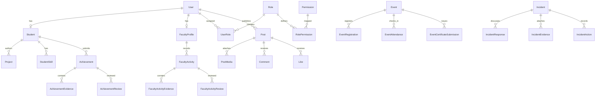

# Data Model Specification: SREC Connect v3.0

## 1. Relational Entity Architecture (Neon PostgreSQL + Prisma)

### 1.1 Core Domains & Tables

### 1.2 Key Entity Specifications

1. **User & Identity:**
   - `User`: `id` (UUID), `email` (unique, lowercase), `name`, `avatarUrl`, `status` (`ACTIVE`, `SUSPENDED`), `createdAt`.
   - `Role`: `id`, `name` (`SUPER_ADMIN`, `HOD`, `WEB_MANAGER`, `FACULTY`, `STUDENT`).
   - `Permission`: `id`, `key` (`users.student.create`, `achievements.review`, `incidents.assign`, etc.).
   - `ApprovedEmailDomain`: `id`, `domain` (e.g. `srecnandyal.edu.in`), `isActive`.

2. **Academic Structure:**
   - `Department`: `id`, `code` (`AIML`, `CSE`), `name`, `fullName`, `hodName`, `hodEmail`.
   - `Batch`: `id`, `name` (`2022-2026`), `startYear`, `endYear`.
   - `Section`: `id`, `name` (`A`, `B`), `batchId`.
   - `Student`: `id` (UUID), `userId`, `rollNumber` (unique immutable string), `name`, `batchId`, `sectionId`, `phone`, `bio`, `githubUrl`, `linkedinUrl`.
   - `FacultyProfile`: `id` (UUID), `userId`, `name`, `designation`, `degrees`, `experience`, `specialization`, `googleScholarUrl`.

3. **Social Community:**
   - `Post`: `id` (UUID), `authorId`, `content`, `visibility` (`PUBLIC`, `COLLEGE_ONLY`, `PRIVATE`), `isPinned`, `createdAt`.
   - `PostMedia`: `id`, `postId`, `url` (Cloudflare R2), `thumbnailUrl`, `width`, `height`, `order`.
   - `Comment`: `id`, `postId`, `authorId`, `content`, `parentId` (for replies).
   - `Like`: `id`, `postId`, `userId` (unique composite index `[postId, userId]`).
   - `Bookmark`: `id`, `postId`, `userId` (unique composite index).
   - `Follow`: `id`, `followerId`, `followingId` (unique composite index).

4. **Academic Achievements & Verification:**
   - `Achievement`: `id`, `studentId`, `title`, `category`, `issuer`, `date`, `description`, `status` (`DRAFT`, `PENDING_REVIEW`, `UNDER_REVIEW`, `APPROVED`, `REJECTED`, `RESUBMISSION_REQUIRED`, `WITHDRAWN`).
   - `AchievementEvidence`: `id`, `achievementId`, `fileUrl`, `storageType` (`GDRIVE`, `R2`, `PRIVATE`), `fileName`, `fileSize`.
   - `AchievementReview`: `id`, `achievementId`, `reviewerId`, `decision`, `comments`, `createdAt`.

5. **Events & Attendance:**
   - `Event`: `id`, `title`, `description`, `type` (`WORKSHOP`, `HACKATHON`, `SEMINAR`), `startTime`, `endTime`, `venue`, `capacity`, `registrationDeadline`, `organizerId`, `whatsappGroupUrl`.
   - `EventRegistration`: `id`, `eventId`, `userId`, `status` (`REGISTERED`, `WAITLISTED`, `CANCELLED`), `registeredAt`.
   - `EventAttendance`: `id`, `eventId`, `userId`, `checkInMethod` (`MANUAL`, `QR_SCAN`), `checkedInAt`, `checkedInBy`.

6. **Complaints & Discipline:**
   - `Incident`: `id`, `reporterId`, `studentId` (accused), `category`, `priority` (`LOW`, `MEDIUM`, `HIGH`, `CRITICAL`), `title`, `description`, `isConfidentialHOD`, `status` (`REPORTED`, `UNDER_REVIEW`, `AWAITING_STUDENT_RESPONSE`, `ACTION_REQUIRED`, `ESCALATED_TO_HOD`, `RESOLVED`, `DISMISSED`).
   - `IncidentResponse`: `id`, `incidentId`, `authorId`, `message`, `createdAt` (immutable, cannot be updated or deleted).
   - `IncidentAction`: `id`, `incidentId`, `actorId`, `outcome` (`VERBAL_WARNING`, `WRITTEN_WARNING`, `COUNSELLING`, `CORRECTIVE_TASK`, `HOD_REVIEW`, `FORMAL_ACTION`, `NO_ACTION`).
