# Master Implementation Plan: SREC Connect v3.0

## Phase Overview & Wave Scheduling

```mermaid
gantt
    title SREC Connect v3.0 Implementation Waves
    dateFormat  X
    axisFormat Wave %s
    section Phase 0
    Discovery & Architecture Lock :0, 1
    section Wave 1 (Foundations)
    Phase 1 Foundation & Design System :1, 2
    Phase 2 Database & Auth Engine     :2, 3
    section Wave 2 (Core Entities)
    Phase 3 User & Academic Admin     :3, 4
    Phase 4 Profiles & Portfolios      :4, 5
    section Wave 3 (Community & Events)
    Phase 5 Social Feed & R2 Media     :5, 6
    Phase 6 Achievements Verification  :6, 7
    Phase 7 Events & QR Check-in       :7, 8
    section Wave 4 (Ops & Hardening)
    Phase 8 Complaints & Discipline    :8, 9
    Phase 9 Google Drive & Notices     :9, 10
    Phase 10 Analytics & Public Portal :10, 11
    Phase 11 Production Hardening      :11, 12
```

## Task Checklist & Milestones

### Phase 1: Foundation & Design System
- [ ] Task 1.1: Verify Next.js 15, Tailwind, and theme provider setup.
- [ ] Task 1.2: Build Mobile Bottom Nav & Desktop Sidebar.
- [ ] Task 1.3: Build Public Landing Shell with placeholders.

### Phase 2: Database & Authentication
- [ ] Task 2.1: Update Prisma schema with 5 roles and granular permissions.
- [ ] Task 2.2: Implement Google OAuth server callback with pre-provisioned allowlist match.
- [ ] Task 2.3: Initial Super Admin bootstrapping script.

### Phase 3: User & Academic Admin
- [ ] Task 3.1: Bulk CSV/XLSX import with preview and validation.
- [ ] Task 3.2: Roll-number uniqueness and batch/section relationships.
- [ ] Task 3.3: Administrative edit workflow with audit logs.

### Phase 4: Profiles & Portfolios
- [ ] Task 4.1: Student profile view with lock on official identity fields.
- [ ] Task 4.2: Faculty and HOD professional portfolio dashboards.
- [ ] Task 4.3: Granular privacy toggles (Public / College-Only / Private).

### Phase 5: Social Community & Feed
- [ ] Task 5.1: Post composer supporting max 2 images with Sharp WebP compression.
- [ ] Task 5.2: Cloudflare R2 presigned upload pipeline.
- [ ] Task 5.3: Feed rendering with likes, comments, bookmarks, and reporting.

### Phase 6: Achievements & Verification
- [ ] Task 6.1: Student achievement submission with proof document upload.
- [ ] Task 6.2: Faculty review queue with Approve / Reject / Resubmit actions.
- [ ] Task 6.3: HOD dispute resolution and audit trail.

### Phase 7: Events & QR Attendance
- [ ] Task 7.1: Event creation with seat limits and optional WhatsApp group link.
- [ ] Task 7.2: Transactional student registration and waitlist management.
- [ ] Task 7.3: Event check-in via organizer toggle and event-specific QR scanner.

### Phase 8: Complaints & Discipline Management
- [ ] Task 8.1: Dual-track reporting forms (Grievance vs Incident Report).
- [ ] Task 8.2: Confidential HOD bypass workflow.
- [ ] Task 8.3: Immutable response timeline with student right-to-respond.

### Phase 9: Google Drive & Notifications
- [ ] Task 9.1: Google Drive backend service for verified certificates.
- [ ] Task 9.2: Announcements system with audience filtering.
- [ ] Task 9.3: In-app notification center and user preference controls.

### Phase 10: Analytics & Public Portal
- [ ] Task 10.1: Department metrics with Recharts.
- [ ] Task 10.2: Role-aware global search.
- [ ] Task 10.3: Public SEO metadata and sitemap generation.

### Phase 11: Production Readiness & Hardening
- [ ] Task 11.1: Complete Vitest unit suite and Playwright end-to-end tests.
- [ ] Task 11.2: Security audit (OWASP, IDOR, CSRF, rate limits).
- [ ] Task 11.3: Production build verification and deployment sign-off.
